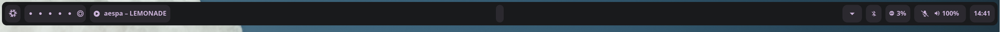

# ags-bar
## Introduction

This is a bar I made using AGS/Astal, for use on my personal NixOS machine. It likely also works on other
distros, I just haven't tried.

## Preview
Here is a screenshot of the bar, more might be added later.



## Features
- Menu to quickly shutdown/reboot/open terminal
- Hyprland workspaces indicator
- Mpris integration for music info/control
- Currently active Hyprland window indicator
- Tray submenu
- Simple bluetooth indicator/menu
- CPU usage indicator
- Audio control
- Clock

## Installation / Usage

1. Add the repository to your flake inputs:
```nix
ags-bar = {
    url = "github:itsyunaya/ags-bar";
    inputs.nixpkgs.follows = "nixpkgs";
}; 
```

2. Add it to your packages in your preferred manner (Example:)
```nix
let
    ags-bar = inputs.ags-bar.packages.${pkgs.stdenv.hostPlatform.system}.default;
in environment.systemPackages = [
    ags-bar
];
```

3. Rebuild your system and add the bar to your autostart method.